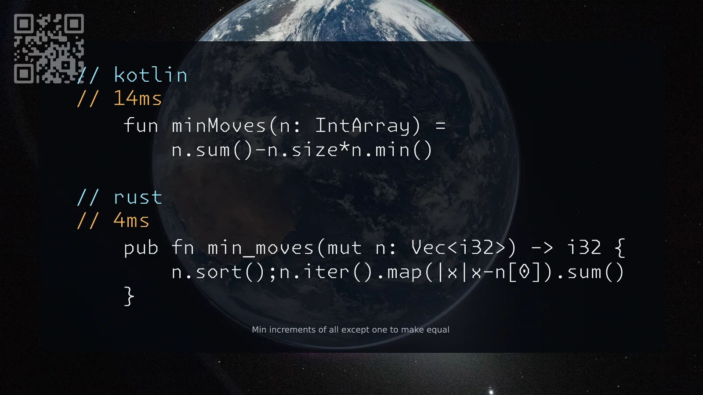

[453. Minimum Moves to Equal Array Elements](https://leetcode.com/problems/minimum-moves-to-equal-array-elements/solutions/8597102/kotlin-rust-by-samoylenkodmitry-9pqv/) medium
[substack](https://dmitriisamoilenko.substack.com/p/01112026-453-minimum-moves-to-equal?r=2bam17&utm_campaign=post&utm_medium=web&showWelcomeOnShare=true)
[youtube](https://youtu.be/8Amh6qlu_Ks)

https://dmitrysamoylenko.com/leetcode/


#### Join me on Telegram

https://t.me/leetcode_daily_unstoppable/1529

#### Problem TLDR

Min increments of all except one to make equal

#### Intuition

Each number got incremented by it's difference with min.

#### Approach

* we can sort and simulate or just find the min

#### Complexity

- Time complexity:
$$O(n)$$

- Space complexity:
$$O(1)$$

#### Code

```kotlin
    fun minMoves(n: IntArray) =
        n.sum()-n.size*n.min()
```
```rust
    pub fn min_moves(mut n: Vec<i32>) -> i32 {
        n.sort();n.iter().map(|x|x-n[0]).sum()
    }
```

