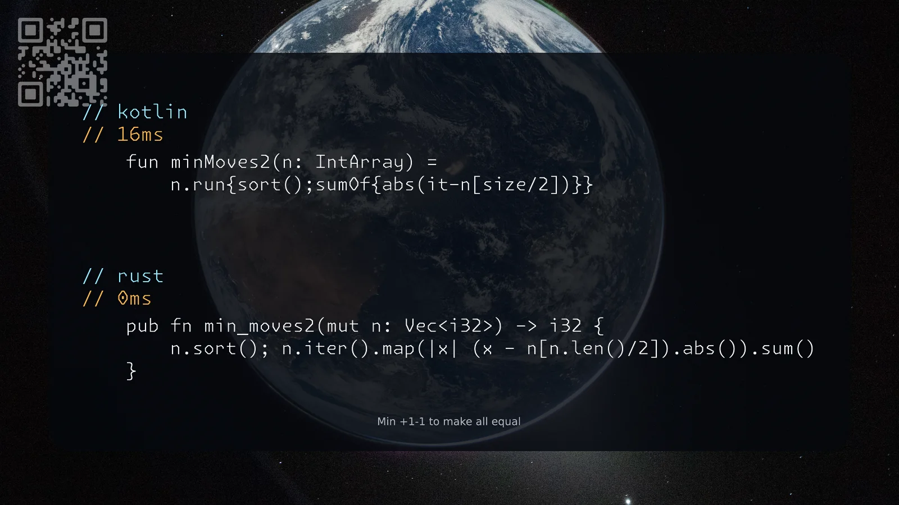

[462. Minimum Moves to Equal Array Elements II](https://leetcode.com/problems/minimum-moves-to-equal-array-elements-ii/solutions/8598724/kotlin-rust-by-samoylenkodmitry-tgrb/) medium
[substack](https://dmitriisamoilenko.substack.com/p/02112026-462-minimum-moves-to-equal?r=2bam17&utm_campaign=post&utm_medium=web&showWelcomeOnShare=true)
[youtube](https://youtu.be/XjrTVdvPst4)

https://dmitrysamoylenko.com/leetcode/


#### Join me on Telegram

https://t.me/leetcode_daily_unstoppable/1530

#### Problem TLDR

Min +1-1 to make all equal

#### Intuition

Median is the optimal baseline

#### Approach

* quickselect would make it O(n)

#### Complexity

- Time complexity:
$$O(nlogn)$$

- Space complexity:
$$O(1)$$

#### Code

```kotlin
    fun minMoves2(n: IntArray) =
        n.run{sort();sumOf{abs(it-n[size/2])}}
```
```rust
    pub fn min_moves2(mut n: Vec<i32>) -> i32 {
        n.sort(); n.iter().map(|x| (x - n[n.len()/2]).abs()).sum()
    }
```

