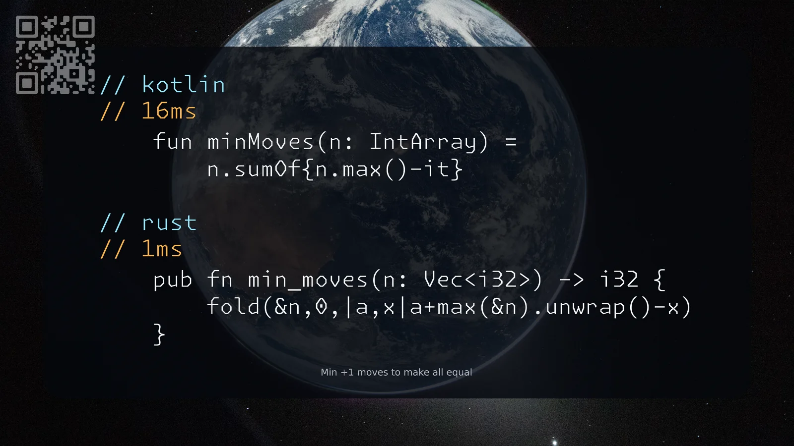

[3736. Minimum Moves to Equal Array Elements III](https://leetcode.com/problems/minimum-moves-to-equal-array-elements-iii/solutions/8600109/kotlin-rust-by-samoylenkodmitry-bqin/) easy
[substack](https://dmitriisamoilenko.substack.com/p/03112026-3736-minimum-moves-to-equal?r=2bam17&utm_campaign=post&utm_medium=web&showWelcomeOnShare=true)
[youtube](https://youtu.be/asf17iwziUc)

https://dmitrysamoylenko.com/leetcode/


#### Join me on Telegram

https://t.me/leetcode_daily_unstoppable/1531

#### Problem TLDR

Min +1 moves to make all equal

#### Intuition

Up each to the maximum

#### Approach

* or look at geometry area of maximum * length - sum()

#### Complexity

- Time complexity:
$$O(n^2)$$

- Space complexity:
$$O(1)$$

#### Code

```kotlin
    fun minMoves(n: IntArray) =
        n.sumOf{n.max()-it}
```
```rust
    pub fn min_moves(n: Vec<i32>) -> i32 {
        fold(&n,0,|a,x|a+max(&n).unwrap()-x)
    }
```

