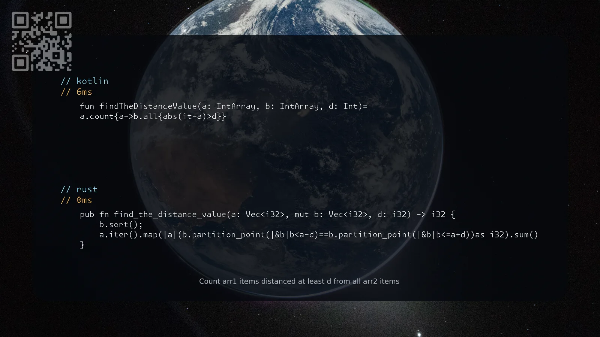

[1385. Find the Distance Value Between Two Arrays](https://leetcode.com/problems/find-the-distance-value-between-two-arrays/solutions/8602532/kotlin-rust-by-samoylenkodmitry-8cck/) easy
[substack](https://dmitriisamoilenko.substack.com/p/05112026-1385-find-the-distance-value?r=2bam17&utm_campaign=post&utm_medium=web&showWelcomeOnShare=true)
[youtube](https://youtu.be/kXQHUazu1P4)

https://dmitrysamoylenko.com/leetcode/


#### Join me on Telegram

https://t.me/leetcode_daily_unstoppable/1533

#### Problem TLDR

Count arr1 items distanced at least d from all arr2 items

#### Intuition

Brute-force check.
Optimal: sort the second array, check that range [a-d..a+d] doesn't have any value in the second array.

#### Approach

* Go to the comments section of the leetcode to understand the description of the problem.
* Rust: partition_point of both range ends should be the same, that way no value is inside the range

#### Complexity

- Time complexity:
$$O(n^2)$$

- Space complexity:
$$O(1)$$

#### Code

```kotlin
    fun findTheDistanceValue(a: IntArray, b: IntArray, d: Int)=
    a.count{a->b.all{abs(it-a)>d}}
```
```rust
    pub fn find_the_distance_value(a: Vec<i32>, mut b: Vec<i32>, d: i32) -> i32 {
        b.sort();
        a.iter().map(|a|(b.partition_point(|&b|b<a-d)==b.partition_point(|&b|b<=a+d))as i32).sum()
    }
```

