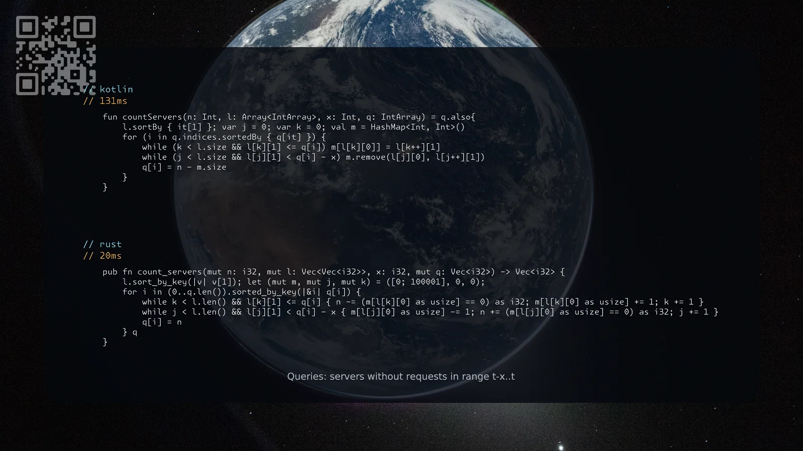

[2747. Count Zero Request Servers](https://leetcode.com/problems/count-zero-request-servers/solutions/8603616/kotlin-rust-by-samoylenkodmitry-sctw/) medium
[substack](https://dmitriisamoilenko.substack.com/p/06112026-2747-count-zero-request?r=2bam17&utm_campaign=post&utm_medium=web&showWelcomeOnShare=true)
[youtube](https://youtu.be/8Vu8xjPg-Mc)

https://dmitrysamoylenko.com/leetcode/


#### Join me on Telegram

https://t.me/leetcode_daily_unstoppable/1534

#### Problem TLDR

Queries: servers without requests in range t-x..t

#### Intuition

Sort both. Two pointers on requests logs, move time forward for each query. First pointer moves with time and adds ids. Second pointer moves until t-x and removes ids.

#### Approach

* we can just store the last query time instead of counting.

#### Complexity

- Time complexity:
$$O(nlogn)$$

- Space complexity:
$$O(n)$$

#### Code

```kotlin
    fun countServers(n: Int, l: Array<IntArray>, x: Int, q: IntArray) = q.also{
        l.sortBy { it[1] }; var j = 0; var k = 0; val m = HashMap<Int, Int>()
        for (i in q.indices.sortedBy { q[it] }) {
            while (k < l.size && l[k][1] <= q[i]) m[l[k][0]] = l[k++][1]
            while (j < l.size && l[j][1] < q[i] - x) m.remove(l[j][0], l[j++][1])
            q[i] = n - m.size
        }
    }
```
```rust
    pub fn count_servers(mut n: i32, mut l: Vec<Vec<i32>>, x: i32, mut q: Vec<i32>) -> Vec<i32> {
        l.sort_by_key(|v| v[1]); let (mut m, mut j, mut k) = ([0; 100001], 0, 0);
        for i in (0..q.len()).sorted_by_key(|&i| q[i]) {
            while k < l.len() && l[k][1] <= q[i] { n -= (m[l[k][0] as usize] == 0) as i32; m[l[k][0] as usize] += 1; k += 1 }
            while j < l.len() && l[j][1] < q[i] - x { m[l[j][0] as usize] -= 1; n += (m[l[j][0] as usize] == 0) as i32; j += 1 }
            q[i] = n
        } q
    }
```

