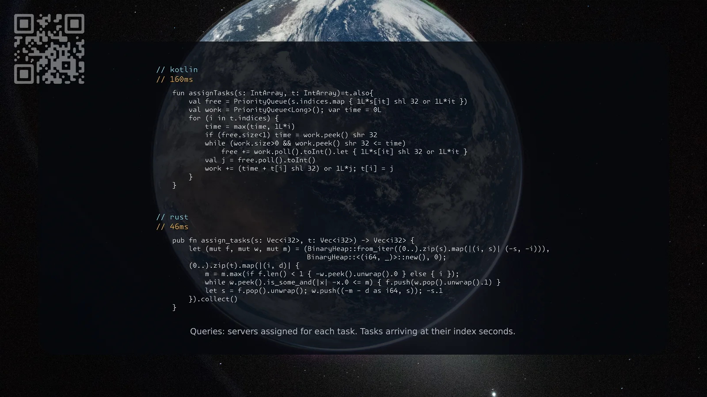

[1882. Process Tasks Using Servers](https://leetcode.com/problems/process-tasks-using-servers/solutions/8604491/kotlin-rust-by-samoylenkodmitry-nner/) medium
[substack](https://dmitriisamoilenko.substack.com/p/07112026-1882-process-tasks-using?r=2bam17&utm_campaign=post&utm_medium=web&showWelcomeOnShare=true)
[youtube](https://youtu.be/vVjtBWxLB-M)

https://dmitrysamoylenko.com/leetcode/


#### Join me on Telegram

https://t.me/leetcode_daily_unstoppable/1535

#### Problem TLDR

Queries: servers assigned for each task. Tasks arriving at their index seconds.

#### Intuition

Two heaps: one for busy (time stop, index), one for free (weight, index).

#### Approach

* adjust the global time with the current task's time if needed

#### Complexity

- Time complexity:
$$O(nlogn)$$

- Space complexity:
$$O(n)$$

#### Code

```kotlin
    fun assignTasks(s: IntArray, t: IntArray)=t.also{
        val free = PriorityQueue(s.indices.map { 1L*s[it] shl 32 or 1L*it })
        val work = PriorityQueue<Long>(); var time = 0L
        for (i in t.indices) {
            time = max(time, 1L*i)
            if (free.size<1) time = work.peek() shr 32
            while (work.size>0 && work.peek() shr 32 <= time)
                free += work.poll().toInt().let { 1L*s[it] shl 32 or 1L*it }
            val j = free.poll().toInt()
            work += (time + t[i] shl 32) or 1L*j; t[i] = j
        }
    }
```
```rust
    pub fn assign_tasks(s: Vec<i32>, t: Vec<i32>) -> Vec<i32> {
        let (mut f, mut w, mut m) = (BinaryHeap::from_iter((0..).zip(s).map(|(i, s)| (-s, -i))),
                                     BinaryHeap::<(i64, _)>::new(), 0);
        (0..).zip(t).map(|(i, d)| {
            m = m.max(if f.len() < 1 { -w.peek().unwrap().0 } else { i });
            while w.peek().is_some_and(|x| -x.0 <= m) { f.push(w.pop().unwrap().1) }
            let s = f.pop().unwrap(); w.push((-m - d as i64, s)); -s.1
        }).collect()
    }
```

