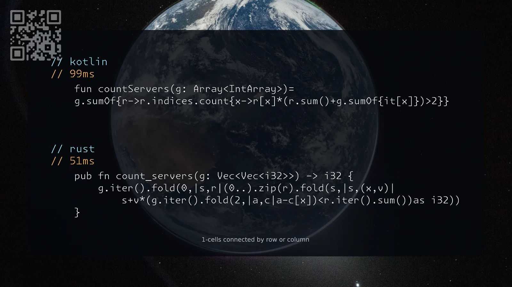

[1267. Count Servers that Communicate](https://leetcode.com/problems/count-servers-that-communicate/solutions/8605713/kotlin-rust-by-samoylenkodmitry-5zp0/) medium
[substack](https://dmitriisamoilenko.substack.com/p/08112026-1267-count-servers-that?r=2bam17&utm_campaign=post&utm_medium=web&showWelcomeOnShare=true)
[youtube](https://youtu.be/nlD7EFY60uE)

https://dmitrysamoylenko.com/leetcode/


#### Join me on Telegram

https://t.me/leetcode_daily_unstoppable/1536

#### Problem TLDR

1-cells connected by row or column

#### Intuition

Brute-force

#### Approach

* column sum + row sum > 2

#### Complexity

- Time complexity:
$$O(n^3)$$

- Space complexity:
$$O(1)$$

#### Code

```kotlin
    fun countServers(g: Array<IntArray>)=
    g.sumOf{r->r.indices.count{x->r[x]*(r.sum()+g.sumOf{it[x]})>2}}
```
```rust
    pub fn count_servers(g: Vec<Vec<i32>>) -> i32 {
        g.iter().fold(0,|s,r|(0..).zip(r).fold(s,|s,(x,v)|
            s+v*(g.iter().fold(2,|a,c|a-c[x])<r.iter().sum())as i32))
    }
```

