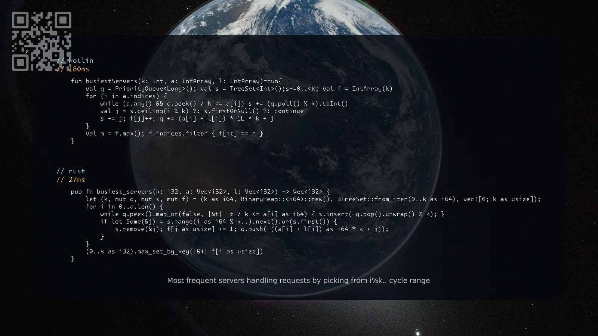

[1606. Find Servers That Handled Most Number of Requests](https://leetcode.com/problems/find-servers-that-handled-most-number-of-requests/solutions/8606621/kotlin-rust-by-samoylenkodmitry-f3by/) hard
[substack](https://dmitriisamoilenko.substack.com/p/09112026-1606-find-servers-that-handled?r=2bam17&utm_campaign=post&utm_medium=web&showWelcomeOnShare=true)
[youtube](https://youtu.be/C1zVL5owbHo)

https://dmitrysamoylenko.com/leetcode/


#### Join me on Telegram

https://t.me/leetcode_daily_unstoppable/1537

#### Problem TLDR

Most frequent servers handling requests by picking from i%k.. cycle range

#### Intuition

Simulate the process. Maintain the busy servers by sorted time and free servers by sorted indices. Split free into head and tail.

#### Approach

* TreeSet ceiling(x) in kotlin and BTreeSet.range(x..).next() give the exactly equal or greater value
* Rust itertools: max_set_by_key

#### Complexity

- Time complexity:
$$O(nlogn)$$

- Space complexity:
$$O(n)$$

#### Code

```kotlin
    fun busiestServers(k: Int, a: IntArray, l: IntArray)=run{
        val q = PriorityQueue<Long>(); val s = TreeSet<Int>();s+=0..<k; val f = IntArray(k)
        for (i in a.indices) {
            while (q.any() && q.peek() / k <= a[i]) s += (q.poll() % k).toInt()
            val j = s.ceiling(i % k) ?: s.firstOrNull() ?: continue
            s -= j; f[j]++; q += (a[i] + l[i]) * 1L * k + j
        }
        val m = f.max(); f.indices.filter { f[it] == m }
    }
```
```rust
    pub fn busiest_servers(k: i32, a: Vec<i32>, l: Vec<i32>) -> Vec<i32> {
        let (k, mut q, mut s, mut f) = (k as i64, BinaryHeap::<i64>::new(), BTreeSet::from_iter(0..k as i64), vec![0; k as usize]);
        for i in 0..a.len() {
            while q.peek().map_or(false, |&t| -t / k <= a[i] as i64) { s.insert(-q.pop().unwrap() % k); }
            if let Some(&j) = s.range(i as i64 % k..).next().or(s.first()) {
                s.remove(&j); f[j as usize] += 1; q.push(-((a[i] + l[i]) as i64 * k + j));
            }
        }
        (0..k as i32).max_set_by_key(|&i| f[i as usize])
    }
```

