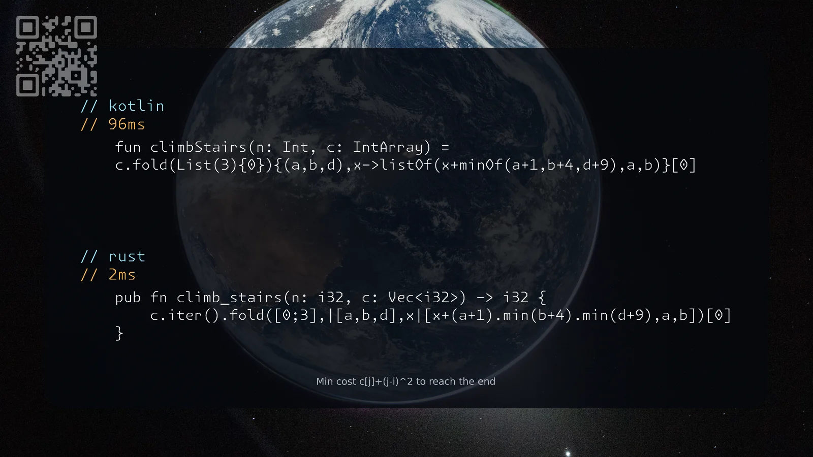

[3693. Climbing Stairs II](https://leetcode.com/problems/climbing-stairs-ii/solutions/8607746/kotlin-rust-by-samoylenkodmitry-4tov/) medium
[substack](https://dmitriisamoilenko.substack.com/p/10112026-3693-climbing-stairs-ii?r=2bam17&utm_campaign=post-expanded-share&utm_medium=web)
[youtube](https://youtu.be/vbGLaqy7HCQ)

https://dmitrysamoylenko.com/leetcode/


#### Join me on Telegram

https://t.me/leetcode_daily_unstoppable/1538

#### Problem TLDR

Min cost c[j]+(j-i)^2 to reach the end

#### Intuition

Attention to the *1-indexed* part. Otherwise it is a basic choice problem of the last 3 choices.

#### Approach

* we can modify c in place
* fold is the shortest

#### Complexity

- Time complexity:
$$O(n)$$

- Space complexity:
$$O(n)$$

#### Code

```kotlin
    fun climbStairs(n: Int, c: IntArray) =
    c.fold(List(3){0}){(a,b,d),x->listOf(x+minOf(a+1,b+4,d+9),a,b)}[0]
```
```rust
    pub fn climb_stairs(n: i32, c: Vec<i32>) -> i32 {
        c.iter().fold([0;3],|[a,b,d],x|[x+(a+1).min(b+4).min(d+9),a,b])[0]
    }
```

