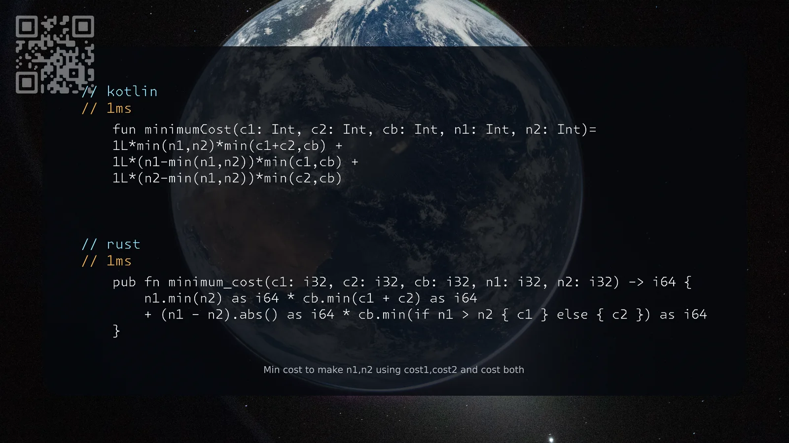

[3789. Minimum Cost to Acquire Required Items](https://leetcode.com/problems/minimum-cost-to-acquire-required-items/solutions/8609101/kotlin-rust-by-samoylenkodmitry-k4ux/) medium
[substack](https://dmitriisamoilenko.substack.com/p/11112026-3789-minimum-cost-to-acquire?r=2bam17&utm_campaign=post&utm_medium=web&showWelcomeOnShare=true)
[youtube](https://youtu.be/QB0ONX6BPiA)

https://dmitrysamoylenko.com/leetcode/


#### Join me on Telegram

https://t.me/leetcode_daily_unstoppable/1539

#### Problem TLDR

Min cost to make n1,n2 using cost1,cost2 and cost both

#### Intuition

This is a corner cases problem. Choose between taking both separately, taking both together using cost both or the combinations.

#### Approach

* we can pick pairs and choose min between c1+c2 and cb
* then add the leftover

#### Complexity

- Time complexity:
$$O(1)$$

- Space complexity:
$$O(1)$$

#### Code

```kotlin
    fun minimumCost(c1: Int, c2: Int, cb: Int, n1: Int, n2: Int)=
    1L*min(n1,n2)*min(c1+c2,cb) +
    1L*(n1-min(n1,n2))*min(c1,cb) +
    1L*(n2-min(n1,n2))*min(c2,cb)
```
```rust
    pub fn minimum_cost(c1: i32, c2: i32, cb: i32, n1: i32, n2: i32) -> i64 {
        n1.min(n2) as i64 * cb.min(c1 + c2) as i64
        + (n1 - n2).abs() as i64 * cb.min(if n1 > n2 { c1 } else { c2 }) as i64
    }
```

