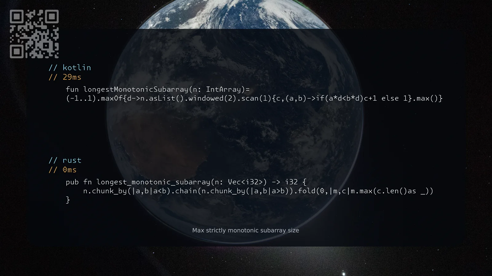

[3105. Longest Strictly Increasing or Strictly Decreasing Subarray](https://leetcode.com/problems/longest-strictly-increasing-or-strictly-decreasing-subarray/solutions/8610201/kotlin-rust-by-samoylenkodmitry-pyle/) easy
[substack](https://dmitriisamoilenko.substack.com/p/12112026-3105-longest-strictly-increasing?r=2bam17&utm_campaign=post&utm_medium=web&showWelcomeOnShare=true)
[youtube](https://youtu.be/QB0ONX6BPiA)

https://dmitrysamoylenko.com/leetcode/


#### Join me on Telegram

https://t.me/leetcode_daily_unstoppable/1540

#### Problem TLDR

Max strictly monotonic subarray size

#### Intuition

Brute-force is accepted, try all windows lengths.

#### Approach

* the optimzal solution is also the shortest

#### Complexity

- Time complexity:
$$O(1)$$

- Space complexity:
$$O(n)$$

#### Code

```kotlin
    fun longestMonotonicSubarray(n: IntArray)=
    (-1..1).maxOf{d->n.asList().windowed(2).scan(1){c,(a,b)->if(a*d<b*d)c+1 else 1}.max()}
```
```rust
    pub fn longest_monotonic_subarray(n: Vec<i32>) -> i32 {
        n.chunk_by(|a,b|a<b).chain(n.chunk_by(|a,b|a>b)).fold(0,|m,c|m.max(c.len()as _))
    }
```

