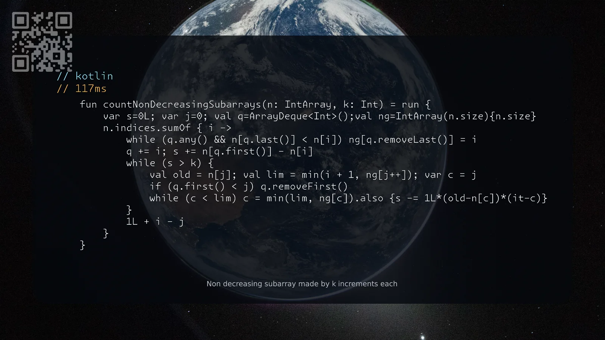

[3420. Count Non-Decreasing Subarrays After K Operations](https://leetcode.com/problems/count-non-decreasing-subarrays-after-k-operations/solutions/8611412/kotlin-rust-by-samoylenkodmitry-i3v6/) hard
[substack](https://dmitriisamoilenko.substack.com/p/13112026-3420-count-non-decreasing?r=2bam17&utm_campaign=post&utm_medium=web&showWelcomeOnShare=true)
[youtube](https://youtu.be/Eu-8q4gvlS0)

https://dmitrysamoylenko.com/leetcode/


#### Join me on Telegram

https://t.me/leetcode_daily_unstoppable/1541

#### Problem TLDR

Non decreasing subarray made by k increments each

#### Intuition

Didn't solved.
```j
    // 6 3 1 2  4  4  k=7
    //   3 5 4  2  2
    //   3 8 12 14 16
    //     2 1  0  0 (x-3).max(0)
    //     2 3  3  3
    //       0  0  0 (x-2).max(0)
    //          0  0
    //             0

    // 7  3  1  3  6
    //    4  6  4  1
    //       2  0  0
    //          0  0
```
* slide window, i expands, j shrinks
* maintain running sum of added diff between current and latest max
* maintain monotonic queue to keep track of maximums and next greater positions
* to shrink use water level technique to find how level decreased between current and next greater, s -= (old level - next greater level)x(next greatter-current)

#### Approach

* i is the next greater to what is popped from the monotonic queue (decreasing queue)

#### Complexity

- Time complexity:
$$O(n)$$

- Space complexity:
$$O(n)$$

#### Code

```kotlin
    fun countNonDecreasingSubarrays(n: IntArray, k: Int) = run {
        var s=0L; var j=0; val q=ArrayDeque<Int>();val ng=IntArray(n.size){n.size}
        n.indices.sumOf { i ->
            while (q.any() && n[q.last()] < n[i]) ng[q.removeLast()] = i
            q += i; s += n[q.first()] - n[i]
            while (s > k) {
                val old = n[j]; val lim = min(i + 1, ng[j++]); var c = j
                if (q.first() < j) q.removeFirst()
                while (c < lim) c = min(lim, ng[c]).also {s -= 1L*(old-n[c])*(it-c)}
            }
            1L + i - j
        }
    }
```
```rust

```

