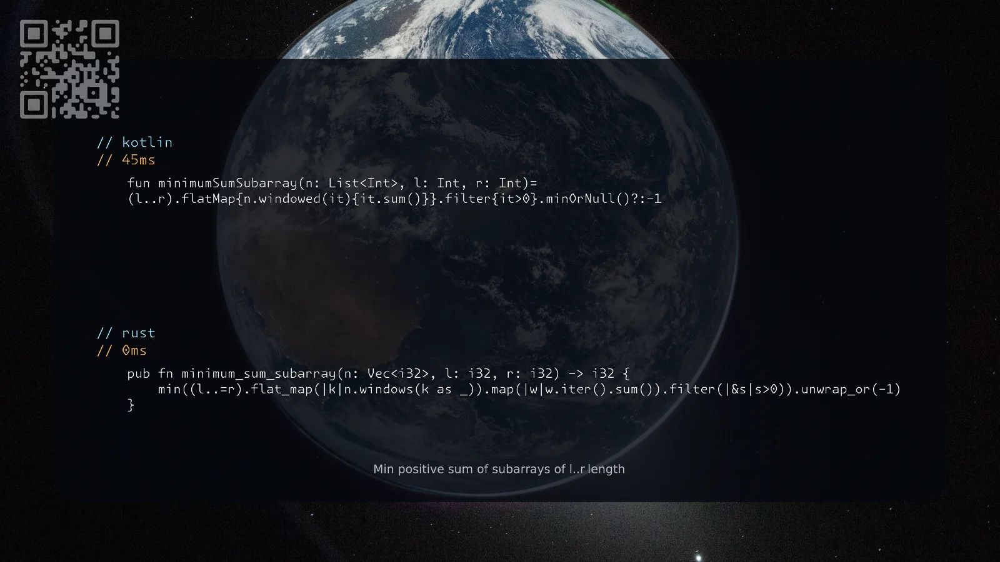

[3364. Minimum Positive Sum Subarray](https://leetcode.com/problems/minimum-positive-sum-subarray/solutions/8612383/kotlin-rust-by-samoylenkodmitry-zbaw/) easy
[substack](https://dmitriisamoilenko.substack.com/p/14112026-3364-minimum-positive-sum?r=2bam17&utm_campaign=post&utm_medium=web&showWelcomeOnShare=true)
[youtube](https://youtu.be/pXIoslxHARg)

https://dmitrysamoylenko.com/leetcode/


#### Join me on Telegram

https://t.me/leetcode_daily_unstoppable/1542

#### Problem TLDR

Min positive sum of subarrays of l..r length

#### Intuition

Brute-force

#### Approach

* pay attention to filter negatives, flatmap if you have to

#### Complexity

- Time complexity:
$$O(n^3)$$

- Space complexity:
$$O(n)$$

#### Code

```kotlin
    fun minimumSumSubarray(n: List<Int>, l: Int, r: Int)=
    (l..r).flatMap{n.windowed(it){it.sum()}}.filter{it>0}.minOrNull()?:-1
```
```rust
    pub fn minimum_sum_subarray(n: Vec<i32>, l: i32, r: i32) -> i32 {
        min((l..=r).flat_map(|k|n.windows(k as _)).map(|w|w.iter().sum()).filter(|&s|s>0)).unwrap_or(-1)
    }
```

