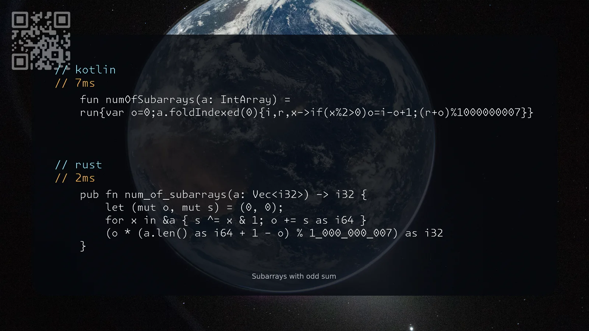

[1524. Number of Sub-arrays With Odd Sum](https://leetcode.com/problems/number-of-sub-arrays-with-odd-sum/solutions/8613441/kotlin-rust-by-samoylenkodmitry-rpk1/) medium
[substack](https://dmitriisamoilenko.substack.com/p/15112026-1524-number-of-sub-arrays?r=2bam17&utm_campaign=post&utm_medium=web&showWelcomeOnShare=true)
[youtube](https://youtu.be/gCTpm3yxp04)

https://dmitrysamoylenko.com/leetcode/


#### Join me on Telegram

https://t.me/leetcode_daily_unstoppable/1543

#### Problem TLDR

Subarrays with odd sum

#### Intuition

```j
    // 1110100001
    // 1000000001
```
Count prefix sums so far, how many are odd, how many are even.
Add a new odd element. If new sum is odd then each even prefix makes odd suffix.
If new sum is even then each odd prefix makes odd suffix.

#### Approach

* for empty prefix we have to initialize even count = 1 (or just rundown some examples to see that)

#### Complexity

- Time complexity:
$$O(n)$$

- Space complexity:
$$O(1)$$

#### Code

```kotlin
    fun numOfSubarrays(a: IntArray) =
    run{var o=0;a.foldIndexed(0){i,r,x->if(x%2>0)o=i-o+1;(r+o)%1000000007}}
```
```rust
    pub fn num_of_subarrays(a: Vec<i32>) -> i32 {
        let (mut o, mut s) = (0, 0);
        for x in &a { s ^= x & 1; o += s as i64 }
        (o * (a.len() as i64 + 1 - o) % 1_000_000_007) as i32
    }
```

