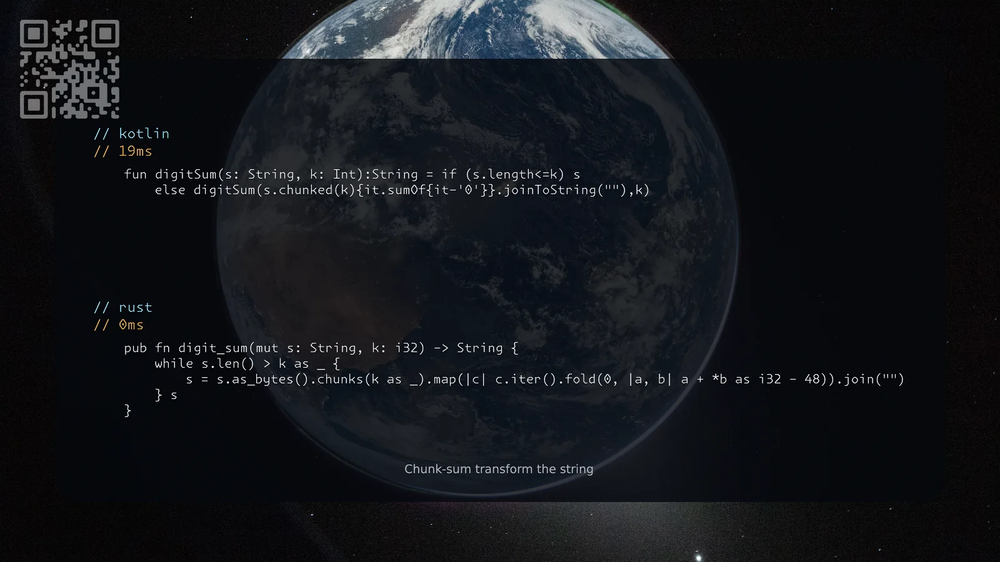

[2243. Calculate Digit Sum of a String](https://leetcode.com/problems/calculate-digit-sum-of-a-string/solutions/8614509/kotlin-rust-by-samoylenkodmitry-wtmm/) easy
[substack](https://dmitriisamoilenko.substack.com/p/16112026-2243-calculate-digit-sum?r=2bam17&utm_campaign=post&utm_medium=web&showWelcomeOnShare=true)
[youtube](https://youtu.be/BZeJUNAOdZg)

https://dmitrysamoylenko.com/leetcode/


#### Join me on Telegram

https://t.me/leetcode_daily_unstoppable/1544

#### Problem TLDR

Chunk-sum transform the string

#### Intuition

Simulate brute-force.

#### Approach

* can use a recursion

#### Complexity

- Time complexity:
$$O(n)$$

- Space complexity:
$$O(n)$$

#### Code

```kotlin
    fun digitSum(s: String, k: Int):String = if (s.length<=k) s
        else digitSum(s.chunked(k){it.sumOf{it-'0'}}.joinToString(""),k)
```
```rust
    pub fn digit_sum(mut s: String, k: i32) -> String {
        while s.len() > k as _ {
            s = s.as_bytes().chunks(k as _).map(|c| c.iter().fold(0, |a, b| a + *b as i32 - 48)).join("")
        } s
    }
```

