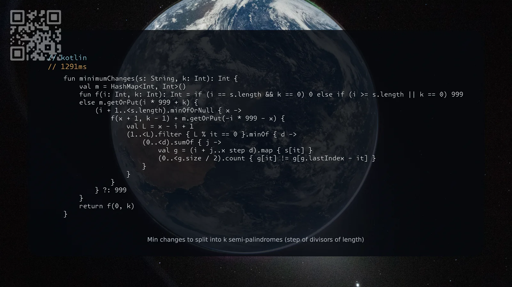

[2911. Minimum Changes to Make K Semi-palindromes](https://leetcode.com/problems/minimum-changes-to-make-k-semi-palindromes/solutions/8615782/kotlin-rust-by-samoylenkodmitry-b5yg/) hard
[substack](https://dmitriisamoilenko.substack.com/p/17112026-2911-minimum-changes-to?r=2bam17&utm_campaign=post&utm_medium=web&showWelcomeOnShare=true)
[youtube](https://youtu.be/TLwUXmNifvg)

https://dmitrysamoylenko.com/leetcode/


#### Join me on Telegram

https://t.me/leetcode_daily_unstoppable/1545

#### Problem TLDR

Min changes to split into k semi-palindromes (step of divisors of length)

#### Intuition

Dp to try every possible split i...end, cache by (i, k). Check semi-palindrome diff with brute force.

#### Approach

* single letter is not a semi-palindrome

#### Complexity

- Time complexity:
$$O(nk)$$

- Space complexity:
$$O(nk)$$

#### Code

```kotlin
    fun minimumChanges(s: String, k: Int): Int {
        val m = HashMap<Int, Int>()
        fun f(i: Int, k: Int): Int = if (i == s.length && k == 0) 0 else if (i >= s.length || k == 0) 999
        else m.getOrPut(i * 999 + k) {
            (i + 1..<s.length).minOfOrNull { x ->
                f(x + 1, k - 1) + m.getOrPut(-i * 999 - x) {
                    val L = x - i + 1
                    (1..<L).filter { L % it == 0 }.minOf { d ->
                        (0..<d).sumOf { j ->
                            val g = (i + j..x step d).map { s[it] }
                            (0..<g.size / 2).count { g[it] != g[g.lastIndex - it] }
                        }
                    }
                }
            } ?: 999
        }
        return f(0, k)
    }
```
```rust

```

