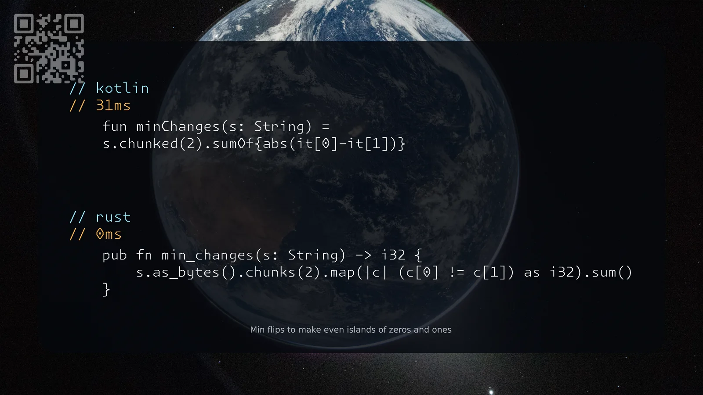

[2914. Minimum Number of Changes to Make Binary String Beautiful](https://leetcode.com/problems/minimum-number-of-changes-to-make-binary-string-beautiful/solutions/8616790/kotlin-rust-by-samoylenkodmitry-qbd7/) medium
[substack](https://dmitriisamoilenko.substack.com/p/18112026-2914-minimum-number-of-changes?r=2bam17&utm_campaign=post&utm_medium=web&showWelcomeOnShare=true)
[youtube](https://youtu.be/pNSguzHuhRM)

https://dmitrysamoylenko.com/leetcode/


#### Join me on Telegram

https://t.me/leetcode_daily_unstoppable/1546

#### Problem TLDR

Min flips to make even islands of zeros and ones

#### Intuition

Greedy workds: consider each pair, if it doesn't matches, we flip a bit. Doesn't mutter how we flip it.

#### Approach

* Kotlin: chunked
* Rust: chunks

#### Complexity

- Time complexity:
$$O(n)$$

- Space complexity:
$$O(1)$$

#### Code

```kotlin
    fun minChanges(s: String) =
    s.chunked(2).sumOf{abs(it[0]-it[1])}
```
```rust
    pub fn min_changes(s: String) -> i32 {
        s.as_bytes().chunks(2).map(|c| (c[0] != c[1]) as i32).sum()
    }
```

