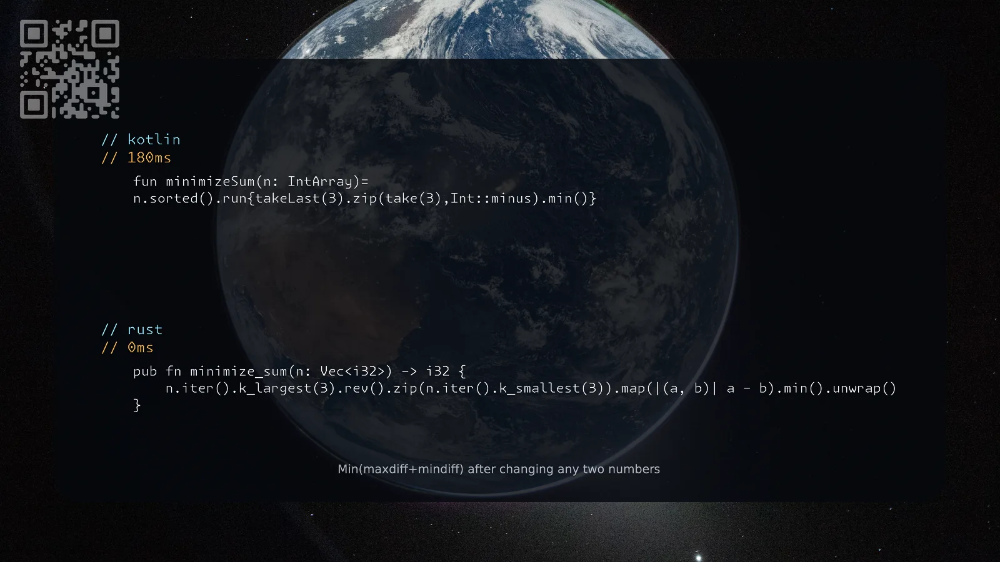

[2567. Minimum Score by Changing Two Elements](https://leetcode.com/problems/minimum-score-by-changing-two-elements/solutions/8617914/kotlin-rust-by-samoylenkodmitry-d3gq/) medium
[substack](https://dmitriisamoilenko.substack.com/p/19112026-2567-minimum-score-by-changing?r=2bam17&utm_campaign=post&utm_medium=web&showWelcomeOnShare=true)
[youtube](https://youtu.be/xse2hyY9lXk)

https://dmitrysamoylenko.com/leetcode/


#### Join me on Telegram

https://t.me/leetcode_daily_unstoppable/1547

#### Problem TLDR

Min(maxdiff+mindiff) after changing any two numbers

#### Intuition

This is the corner cases brain teaser.
Sort. Three cases: change first two, last two or first and last.

#### Approach

* Rust itertools: k_largest, k_smallest
* zip prefix and suffix of sorted order and take min diff

#### Complexity

- Time complexity:
$$O(nlogn | n)$$

- Space complexity:
$$O(1)$$

#### Code

```kotlin
    fun minimizeSum(n: IntArray)=
    n.sorted().run{takeLast(3).zip(take(3),Int::minus).min()}
```
```rust
    pub fn minimize_sum(n: Vec<i32>) -> i32 {
        n.iter().k_largest(3).rev().zip(n.iter().k_smallest(3)).map(|(a, b)| a - b).min().unwrap()
    }
```

