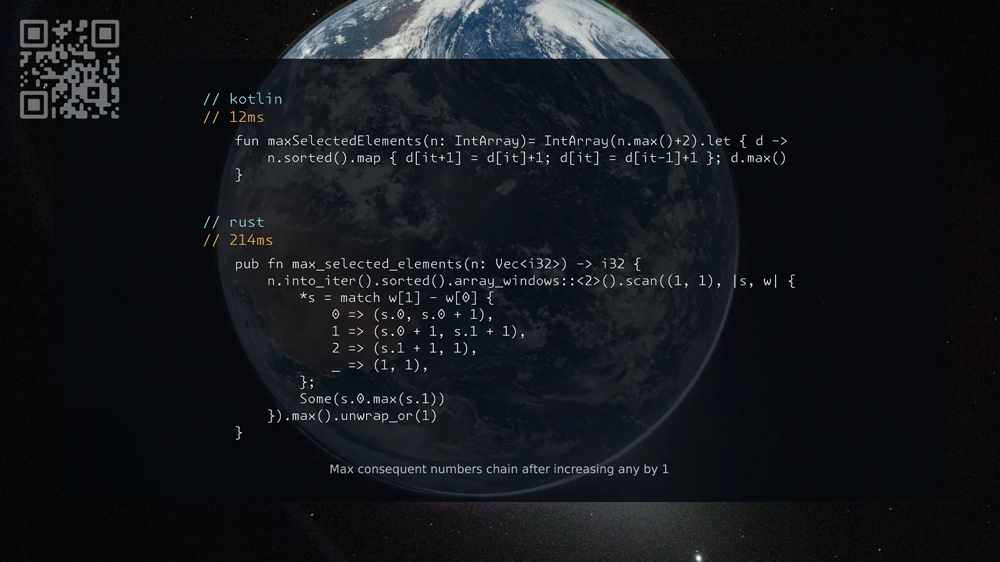

[3041. Maximize Consecutive Elements in an Array After Modification](https://leetcode.com/problems/maximize-consecutive-elements-in-an-array-after-modification/solutions/8618862/kotlin-rust-by-samoylenkodmitry-lyk9/) hard
[substack](https://dmitriisamoilenko.substack.com/p/20112026-3041-maximize-consecutive?r=2bam17&utm_campaign=post&utm_medium=web&showWelcomeOnShare=true)
[youtube](https://youtu.be/yaDG_6onDiw)

https://dmitrysamoylenko.com/leetcode/


#### Join me on Telegram

https://t.me/leetcode_daily_unstoppable/1548

#### Problem TLDR

Max consequent numbers chain after increasing any by 1

#### Intuition

Track the chain length ending with x in a hashmap of value to length

#### Approach

* we can do O(1) space, only two top chains matter

#### Complexity

- Time complexity:
$$O(nlogn)$$

- Space complexity:
$$O(n)$$

#### Code

```kotlin
    fun maxSelectedElements(n: IntArray)= IntArray(n.max()+2).let { d ->
        n.sorted().map { d[it+1] = d[it]+1; d[it] = d[it-1]+1 }; d.max()
    }
```
```rust
    pub fn max_selected_elements(n: Vec<i32>) -> i32 {
        n.into_iter().sorted().array_windows::<2>().scan((1, 1), |s, w| {
            *s = match w[1] - w[0] {
                0 => (s.0, s.0 + 1),
                1 => (s.0 + 1, s.1 + 1),
                2 => (s.1 + 1, 1),
                _ => (1, 1),
            };
            Some(s.0.max(s.1))
        }).max().unwrap_or(1)
    }
```

