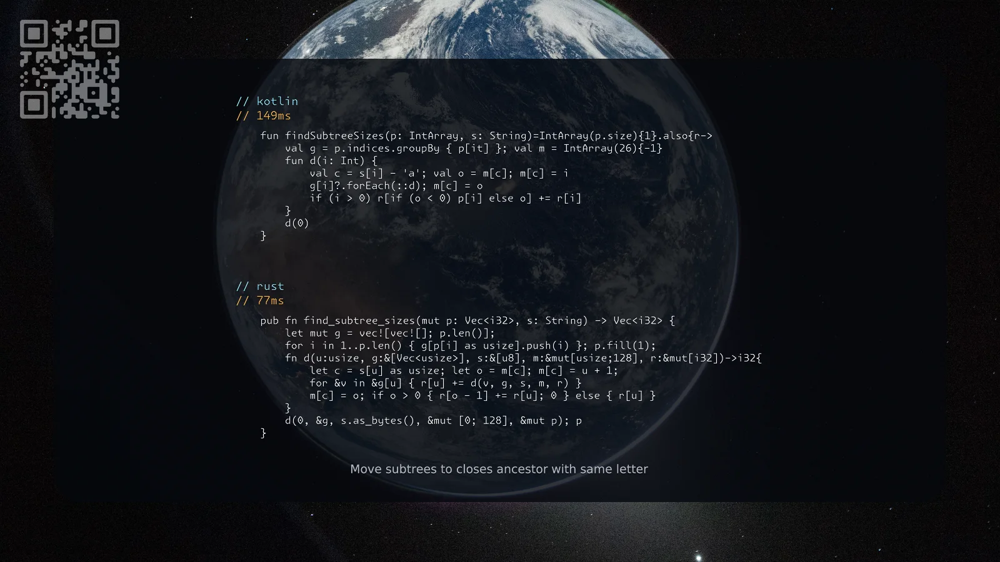

[3331. Find Subtree Sizes After Changes](https://leetcode.com/problems/find-subtree-sizes-after-changes/solutions/8619874/kotlin-rust-by-samoylenkodmitry-t5xr/) medium
[substack](https://dmitriisamoilenko.substack.com/p/21112026-3331-find-subtree-sizes?r=2bam17&utm_campaign=post&utm_medium=web&showWelcomeOnShare=true)
[youtube](https://youtu.be/t9bc692wB2k)

https://dmitrysamoylenko.com/leetcode/


#### Join me on Telegram

https://t.me/leetcode_daily_unstoppable/1549

#### Problem TLDR

Move subtrees to closes ancestor with same letter

#### Intuition

Do two phase DFS: first to re-parent by passing recently visited letters positions, second is to calculate the new sizes

#### Approach

* single pass DFS: at the current node the size is final and the parent is final, so res[parent]+=sz

#### Complexity

- Time complexity:
$$O(n)$$

- Space complexity:
$$O(n)$$

#### Code

```kotlin
    fun findSubtreeSizes(p: IntArray, s: String)=IntArray(p.size){1}.also{r->
        val g = p.indices.groupBy { p[it] }; val m = IntArray(26){-1}
        fun d(i: Int) {
            val c = s[i] - 'a'; val o = m[c]; m[c] = i
            g[i]?.forEach(::d); m[c] = o
            if (i > 0) r[if (o < 0) p[i] else o] += r[i]
        }
        d(0)
    }
```
```rust
    pub fn find_subtree_sizes(mut p: Vec<i32>, s: String) -> Vec<i32> {
        let mut g = vec![vec![]; p.len()];
        for i in 1..p.len() { g[p[i] as usize].push(i) }; p.fill(1);
        fn d(u:usize, g:&[Vec<usize>], s:&[u8], m:&mut[usize;128], r:&mut[i32])->i32{
            let c = s[u] as usize; let o = m[c]; m[c] = u + 1;
            for &v in &g[u] { r[u] += d(v, g, s, m, r) }
            m[c] = o; if o > 0 { r[o - 1] += r[u]; 0 } else { r[u] }
        }
        d(0, &g, s.as_bytes(), &mut [0; 128], &mut p); p
    }
```

