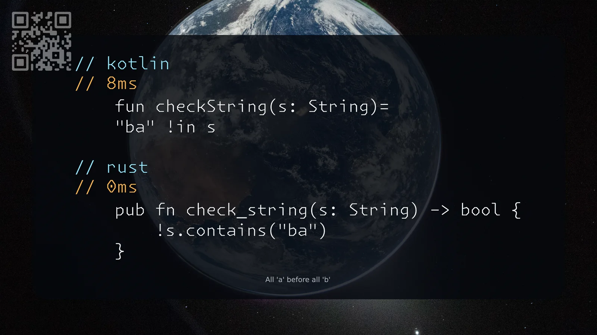

[2124. Check if All A's Appears Before All B's](https://leetcode.com/problems/check-if-all-as-appears-before-all-bs/solutions/8621048/kotlin-rust-by-samoylenkodmitry-2e0t/) easy
[substack](https://dmitriisamoilenko.substack.com/p/22112026-2124-check-if-all-as-appears?r=2bam17&utm_campaign=post&utm_medium=web&showWelcomeOnShare=true)
[youtube](https://youtu.be/mSETybMXQE0)

https://dmitrysamoylenko.com/leetcode/


#### Join me on Telegram

#### Problem TLDR

All 'a' before all 'b'

#### Intuition

Check the regex ^a*b*$ or check the forbidden pattern ba

#### Approach

* all aaa or all bbb considered true

#### Complexity

- Time complexity:
$$O(n)$$

- Space complexity:
$$O(1)$$

#### Code

```kotlin
    fun checkString(s: String)=
    "ba" !in s
```
```rust
    pub fn check_string(s: String) -> bool {
        !s.contains("ba")
    }
```

