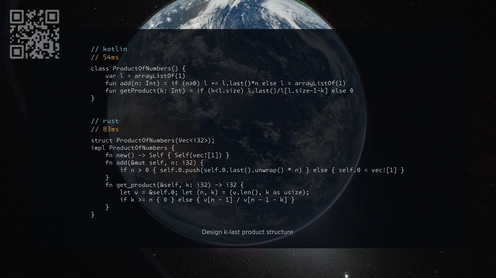

[1352. Product of the Last K Numbers](https://leetcode.com/problems/product-of-the-last-k-numbers/solutions/8622190/kotlin-rust-by-samoylenkodmitry-e8l5/) medium
[substack](https://dmitriisamoilenko.substack.com/p/23112026-1352-product-of-the-last?r=2bam17&utm_campaign=post&utm_medium=web&showWelcomeOnShare=true)
[youtube](https://youtu.be/9OlPyEV0eUY)

https://dmitrysamoylenko.com/leetcode/


#### Join me on Telegram

https://t.me/leetcode_daily_unstoppable/1551

#### Problem TLDR

Design k-last product structure

#### Intuition

Each number multiplies all existing.
Zero purges everything.
One does nothing.
Product can't grow more than 32-bit integer, meaning 2*2*..*2 < 2^32 or at mast 32 numbers will be stored

#### Approach

* can be entiresly O(1) if we multiply only the last one, each number is the prefix product
* prefix product can be converted to suffix product in O(1)

#### Complexity

- Time complexity:
$$O(1)$$

- Space complexity:
$$O(1)$$

#### Code

```kotlin
class ProductOfNumbers() {
    var l = arrayListOf(1)
    fun add(n: Int) = if (n>0) l += l.last()*n else l = arrayListOf(1)
    fun getProduct(k: Int) = if (k<l.size) l.last()/l[l.size-1-k] else 0
}
```
```rust
struct ProductOfNumbers(Vec<i32>);
impl ProductOfNumbers {
    fn new() -> Self { Self(vec![1]) }
    fn add(&mut self, n: i32) {
        if n > 0 { self.0.push(self.0.last().unwrap() * n) } else { self.0 = vec![1] }
    }
    fn get_product(&self, k: i32) -> i32 {
        let v = &self.0; let (n, k) = (v.len(), k as usize);
        if k >= n { 0 } else { v[n - 1] / v[n - 1 - k] }
    }
}
```

