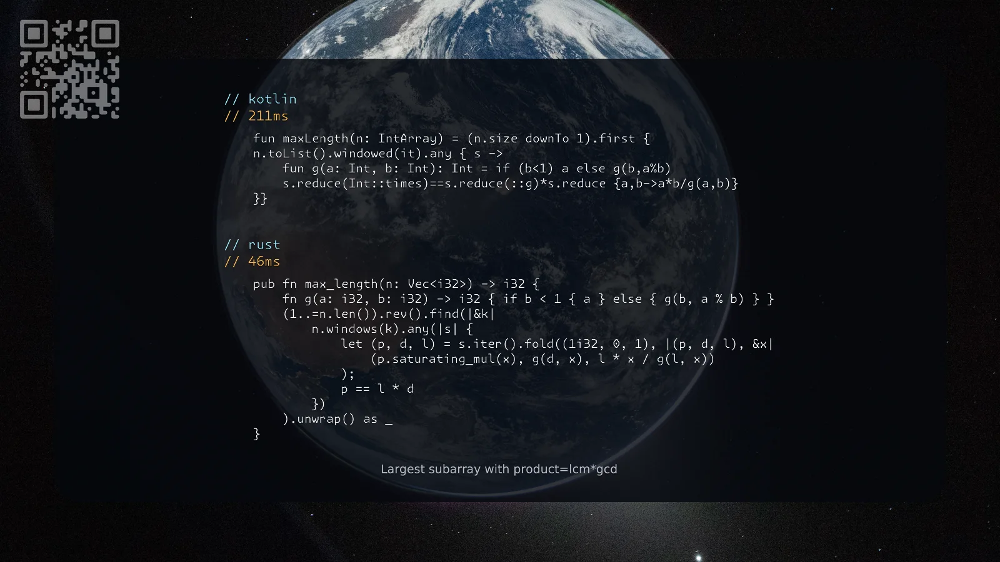

[3411. Maximum Subarray With Equal Products](https://leetcode.com/problems/maximum-subarray-with-equal-products/solutions/8623078/kotlin-rust-by-samoylenkodmitry-nl20/) easy
[substack](https://dmitriisamoilenko.substack.com/p/24112026-3411-maximum-subarray-with?r=2bam17&utm_campaign=post&utm_medium=web&showWelcomeOnShare=true)
[youtube](https://youtu.be/uqCkpH_IHv8)

https://dmitrysamoylenko.com/leetcode/


#### Join me on Telegram

https://t.me/leetcode_daily_unstoppable/1552

#### Problem TLDR

Largest subarray with product=lcm*gcd

#### Intuition

Brute-force just works

#### Approach

* mnemonic to remember gcd: "bab", then add a comma and percent "b,a%b", then f(a,b)=f(b,a%b) and b!=0
* if we factorize with primes, them product = sum(factors), lcm = max(factors), gcd=min(factors); 2^2,2^3,2^5, sum=2+3+5 = min(2)+max(5), means everything between min..max should be 0 and min should be 0, and we can write a solution without gcd

#### Complexity

- Time complexity:
$$O(n^3)$$

- Space complexity:
$$O(n)$$

#### Code

```kotlin
    fun maxLength(n: IntArray) = (n.size downTo 1).first {
    n.toList().windowed(it).any { s ->
        fun g(a: Int, b: Int): Int = if (b<1) a else g(b,a%b)
        s.reduce(Int::times)==s.reduce(::g)*s.reduce {a,b->a*b/g(a,b)}
    }}
```
```rust
    pub fn max_length(n: Vec<i32>) -> i32 {
        fn g(a: i32, b: i32) -> i32 { if b < 1 { a } else { g(b, a % b) } }
        (1..=n.len()).rev().find(|&k|
            n.windows(k).any(|s| {
                let (p, d, l) = s.iter().fold((1i32, 0, 1), |(p, d, l), &x|
                    (p.saturating_mul(x), g(d, x), l * x / g(l, x))
                );
                p == l * d
            })
        ).unwrap() as _
    }
```

