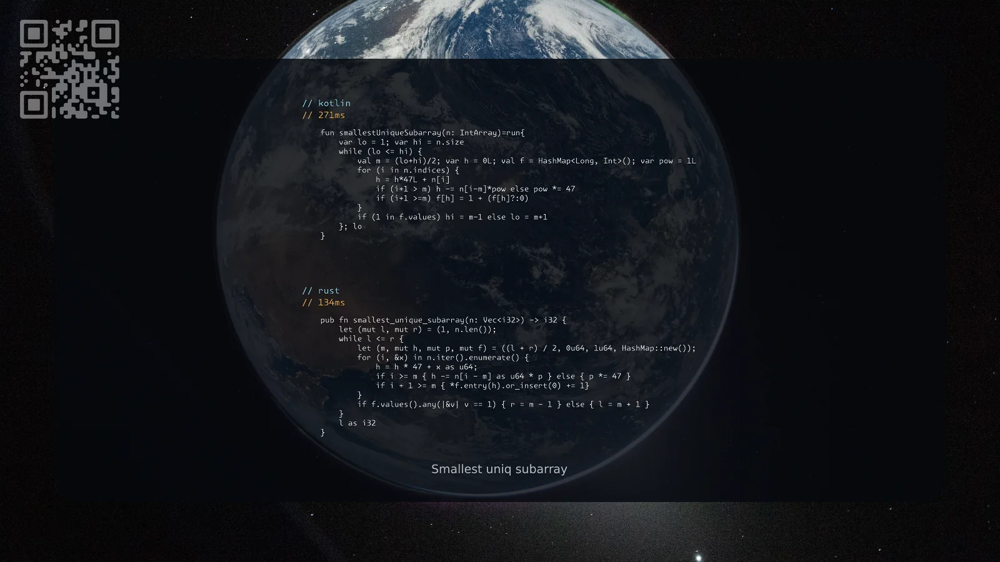

[3934. Smallest Unique Subarray](https://leetcode.com/problems/smallest-unique-subarray/solutions/8624313/kotlin-rust-by-samoylenkodmitry-wzrz/) hard
[substack](https://dmitriisamoilenko.substack.com/p/25112026-3934-smallest-unique-subarray?r=2bam17&utm_campaign=post&utm_medium=web&showWelcomeOnShare=true)
[youtube](https://youtu.be/YfqFu7wEb3o)

https://dmitrysamoylenko.com/leetcode/


#### Join me on Telegram

https://t.me/leetcode_daily_unstoppable/1553

#### Problem TLDR

Smallest uniq subarray

#### Intuition

```j
    // 3 2 1 2 1 1 2 2 3
    // 1 2 3 4 5 4 3 2 1 2 3 4 5 4 3 2 1
    // a*31+b
    // (a*31+b)*31+c = a*31^2 + b*31^1 + c*31^0
```
Used the hints.
If some small subarray is uniq, then any larger subarray grown from it is also uniq.
So the answer is a monotonic function from false false false to true true true and can be binary searched.
Inside the binary search we check sliding window with rolling hash.

#### Approach

* 31 is failing on leetcode, use some other constant or two parallel hashes

#### Complexity

- Time complexity:
$$O(nlogn)$$

- Space complexity:
$$O(1)$$

#### Code

```kotlin
    fun smallestUniqueSubarray(n: IntArray)=run{
        var lo = 1; var hi = n.size
        while (lo <= hi) {
            val m = (lo+hi)/2; var h = 0L; val f = HashMap<Long, Int>(); var pow = 1L
            for (i in n.indices) {
                h = h*47L + n[i]
                if (i+1 > m) h -= n[i-m]*pow else pow *= 47
                if (i+1 >=m) f[h] = 1 + (f[h]?:0)
            }
            if (1 in f.values) hi = m-1 else lo = m+1
        }; lo
    }
```
```rust
    pub fn smallest_unique_subarray(n: Vec<i32>) -> i32 {
        let (mut l, mut r) = (1, n.len());
        while l <= r {
            let (m, mut h, mut p, mut f) = ((l + r) / 2, 0u64, 1u64, HashMap::new());
            for (i, &x) in n.iter().enumerate() {
                h = h * 47 + x as u64;
                if i >= m { h -= n[i - m] as u64 * p } else { p *= 47 }
                if i + 1 >= m { *f.entry(h).or_insert(0) += 1}
            }
            if f.values().any(|&v| v == 1) { r = m - 1 } else { l = m + 1 }
        }
        l as i32
    }
```

