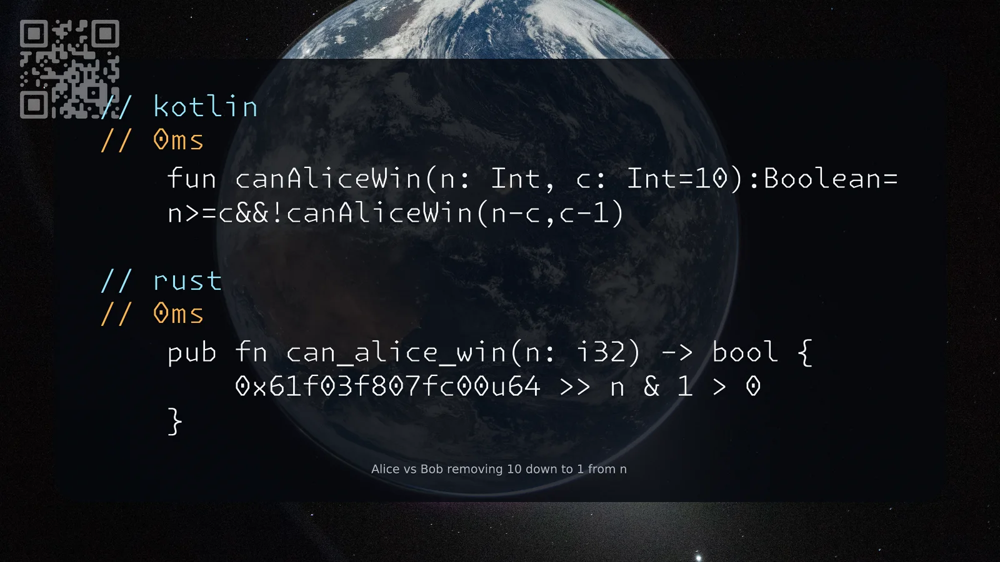

[3360. Stone Removal Game](https://leetcode.com/problems/stone-removal-game/solutions/8625484/kotlin-rust-by-samoylenkodmitry-x7gk/) easy
[substack](https://dmitriisamoilenko.substack.com/p/26112026-3360-stone-removal-game?r=2bam17&utm_campaign=post&utm_medium=web&showWelcomeOnShare=true)
[youtube](https://youtu.be/sqIUDhi0qkI)

https://dmitrysamoylenko.com/leetcode/


#### Join me on Telegram

https://t.me/leetcode_daily_unstoppable/1554

#### Problem TLDR

Alice vs Bob removing 10 down to 1 from n

#### Intuition

Simulate

#### Approach

* the entire answer of all 50 possible arguments can fit into a single 64 bit value

#### Complexity

- Time complexity:
$$O(n)$$

- Space complexity:
$$O(1)$$

#### Code

```kotlin
    fun canAliceWin(n: Int, c: Int=10):Boolean=
    n>=c&&!canAliceWin(n-c,c-1)
```
```rust
    pub fn can_alice_win(n: i32) -> bool {
        0x61f03f807fc00u64 >> n & 1 > 0
    }
```

