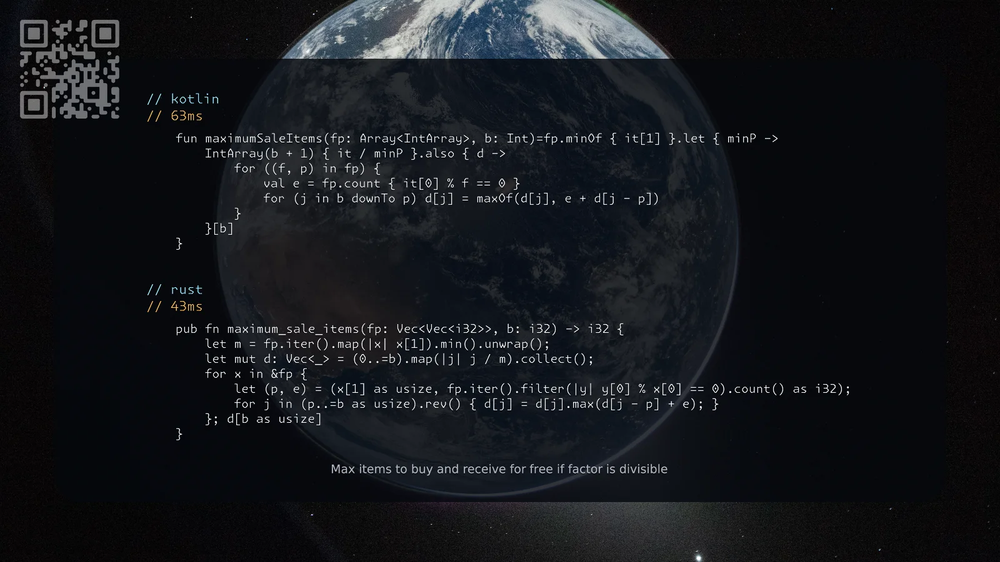

[3946. Maximum Number of Items From Sale I](https://leetcode.com/problems/maximum-number-of-items-from-sale-i/solutions/8626638/kotlin-rust-by-samoylenkodmitry-3t91/) medium
[substack](https://dmitriisamoilenko.substack.com/p/27112026-3946-maximum-number-of-items?r=2bam17&utm_campaign=post&utm_medium=web&showWelcomeOnShare=true)
[youtube](https://youtu.be/ZAgNi_RZTIc)

https://dmitrysamoylenko.com/leetcode/


#### Join me on Telegram

https://t.me/leetcode_daily_unstoppable/1555

#### Problem TLDR

Max items to buy and receive for free if factor is divisible

#### Intuition

Pre-compute for each item how many free items it receives in O(n^2).
The top-down DP gives TLE.

Bottom-up DP[i][j] is the "max items we can obtain using 0..i items and at most j budget.

The bottom-up requires the optimization: first, add free gains for a single purchase j = b downTo p dp[j] = max(free[i]+dp[j-p]), then add remaining items j = b..p dp[j] = max(dp[j-p]+1).

#### Approach

* extra optimization: the remaining items is obviously better to fill with just a lowest price item

#### Complexity

- Time complexity:
$$O(n^2)$$

- Space complexity:
$$O(n)$$

#### Code

```kotlin
    fun maximumSaleItems(fp: Array<IntArray>, b: Int)=fp.minOf { it[1] }.let { minP ->
        IntArray(b + 1) { it / minP }.also { d ->
            for ((f, p) in fp) {
                val e = fp.count { it[0] % f == 0 }
                for (j in b downTo p) d[j] = maxOf(d[j], e + d[j - p])
            }
        }[b]
    }
```
```rust
    pub fn maximum_sale_items(fp: Vec<Vec<i32>>, b: i32) -> i32 {
        let m = fp.iter().map(|x| x[1]).min().unwrap();
        let mut d: Vec<_> = (0..=b).map(|j| j / m).collect();
        for x in &fp {
            let (p, e) = (x[1] as usize, fp.iter().filter(|y| y[0] % x[0] == 0).count() as i32);
            for j in (p..=b as usize).rev() { d[j] = d[j].max(d[j - p] + e); }
        }; d[b as usize]
    }
```

