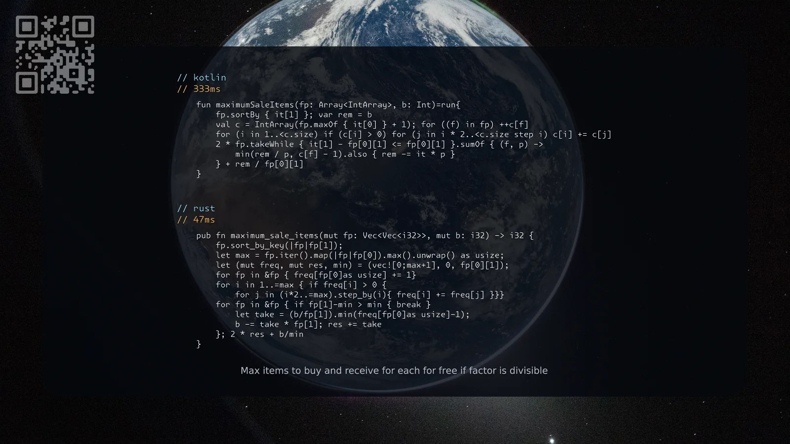

[3947. Maximum Number of Items From Sale II](https://leetcode.com/problems/maximum-number-of-items-from-sale-ii/solutions/8627484/kotlin-rust-by-samoylenkodmitry-bkz7/) medium
[substack](https://dmitriisamoilenko.substack.com/p/28112026-3947-maximum-number-of-items?r=2bam17&utm_campaign=post&utm_medium=web&showWelcomeOnShare=true)
[youtube](https://youtu.be/Lb-gMkLrRwU)

https://dmitrysamoylenko.com/leetcode/


#### Join me on Telegram

https://t.me/leetcode_daily_unstoppable/1556

#### Problem TLDR

Max items to buy and receive for each for free if factor is divisible

#### Intuition

```j
    // you can't even collect factors in O(n^2) because problem is 10^5
    // 7 minute use hints
    // 28 minute: give up, it is greedy with some clever reasoning
```
Didn't solve.

Greedy idea: take as much items with bonuses as possible. Start with lowest price to be greedily optimal. Each item give a signel bonus, so total +2 for each.
The leftovers are filled with lowest cost item b/min_price.
If item with bonus is worse than just buying to lowest cost items then we can stop.

#### Approach

* to count factors in less than O(n^2) iterate over factors frequencies multiples from lower to higher and aggregate

#### Complexity

- Time complexity:
$$O(nlogn)$$

- Space complexity:
$$O(n)$$

#### Code

```kotlin
    fun maximumSaleItems(fp: Array<IntArray>, b: Int)=run{
        fp.sortBy { it[1] }; var rem = b
        val c = IntArray(fp.maxOf { it[0] } + 1); for ((f) in fp) ++c[f]
        for (i in 1..<c.size) if (c[i] > 0) for (j in i * 2..<c.size step i) c[i] += c[j]
        2 * fp.takeWhile { it[1] - fp[0][1] <= fp[0][1] }.sumOf { (f, p) ->
            min(rem / p, c[f] - 1).also { rem -= it * p }
        } + rem / fp[0][1]
    }
```
```rust
    pub fn maximum_sale_items(mut fp: Vec<Vec<i32>>, mut b: i32) -> i32 {
        fp.sort_by_key(|fp|fp[1]);
        let max = fp.iter().map(|fp|fp[0]).max().unwrap() as usize;
        let (mut freq, mut res, min) = (vec![0;max+1], 0, fp[0][1]);
        for fp in &fp { freq[fp[0]as usize] += 1}
        for i in 1..=max { if freq[i] > 0 {
            for j in (i*2..=max).step_by(i){ freq[i] += freq[j] }}}
        for fp in &fp { if fp[1]-min > min { break }
            let take = (b/fp[1]).min(freq[fp[0]as usize]-1);
            b -= take * fp[1]; res += take
        }; 2 * res + b/min
    }
```

